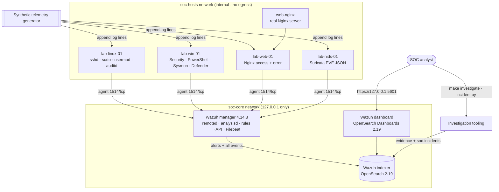
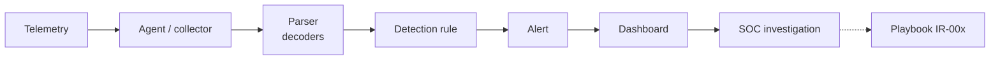

# SOC & SIEM Security Monitoring Lab

A local, reproducible **defensive** SOC laboratory built on Wazuh 4.14.8 (manager, OpenSearch-based indexer
and dashboard). It collects telemetry from Linux, Windows, web and network-IDS sources, normalises it,
detects suspicious behaviour with 36 custom detections mapped to MITRE ATT&CK, feeds an analyst dashboard,
and supports investigation through evidence bundles, an incident tracker and seven IR playbooks. Every
detection is verified automatically through the full pipeline.

> Safety: security scenarios are **synthetic telemetry** (data fixtures). Nothing in the lab attacks, scans
> or contacts any system. See [SECURITY.md](SECURITY.md).

---

## Contents

1. [Objective](#1-objective)
2. [Architecture](#2-architecture)
3. [Technologies](#3-technologies)
4. [Installation](#4-installation)
5. [Configuration](#5-configuration)
6. [Starting the SOC](#6-starting-the-soc)
7. [Detection rules](#7-detection-rules)
8. [Synthetic telemetry](#8-synthetic-telemetry)
9. [Testing](#9-testing)
10. [Incident investigation](#10-incident-investigation)
11. [Incident-response workflow](#11-incident-response-workflow)
12. [Troubleshooting](#12-troubleshooting)
13. [Cleanup](#13-cleanup)
14. [Project structure](#14-project-structure)
15. [Known limitations](#15-known-limitations)

---

## 1. Objective

Build and continuously verify the complete SOC chain:

**telemetry → agent/collector → parser → detection rule → alert → dashboard → SOC investigation**

* Collect security telemetry from four lab hosts (Linux, Windows, web server, network IDS).
* Normalise events with Wazuh decoders (stock + custom).
* Detect authentication abuse, privilege escalation, suspicious PowerShell/process execution, network
  reconnaissance, web reconnaissance and attacks, new administrative accounts, security-control
  tampering and outbound C2.
* Map every detection to MITRE ATT&CK, with severity, data source, false-positive notes and a response.
* Give analysts a dashboard, an investigation tool that writes evidence bundles, an incident tracker and
  playbooks.
* Prove it works: each rule has a positive test that must raise the alert end to end, and benign
  counterparts that must **not** raise it. The suite fails as soon as a detection stops working.

## 2. Architecture





Details, data stores and design decisions: [docs/architecture.md](docs/architecture.md).

## 3. Technologies

| Technology | Version | Used for |
|---|---|---|
| Wazuh manager | 4.14.8 | collection, decoding, rule engine, MITRE enrichment, API, logtest |
| Wazuh indexer | 4.14.8 (OpenSearch 2.19.6) | alert/event/incident storage and search |
| Wazuh dashboard | 4.14.8 (OpenSearch Dashboards 2.19.6) | SOC dashboard, Discover |
| Wazuh agent | 4.14.8 | log collection on the four lab hosts |
| Nginx | 1.27-alpine | real web server and log source |
| Suricata EVE / Sysmon / Windows EventChannel | event formats | network and Windows telemetry (synthetic records) |
| Docker Compose | v2 | orchestration |
| Python | 3.10+ | generator, tests (pytest), investigation tooling |

## 4. Installation

Requirements: Linux x86_64 with Docker Engine and the Compose v2 plugin, Python 3.10+ with `venv`, `curl`,
`jq`, `make`, about **6 GB RAM free** and 10 GB of disk. `make setup` needs Internet access **once** to
pull images, Python packages and the Wazuh certificate tool. After that the lab runs fully offline. OpenSearch also needs:

```bash
sudo sysctl -w vm.max_map_count=262144     # persist in /etc/sysctl.d/ if you like
```

Then:

```bash
cd soc-siem-lab
make setup        # checks prerequisites, creates .env with random lab secrets, venv, TLS certs, pulls images
```

## 5. Configuration

| File | Purpose |
|---|---|
| `.env` (from `.env.example`) | versions, generated lab passwords, host ports (bound to 127.0.0.1), indexer heap |
| `wazuh/manager/etc/ossec.conf` | manager config: archives on, vulnerability feeds off, logtest on, agent re-enrollment |
| `wazuh/manager/etc/rules/soc_lab_rules.xml` | the SOC lab detections (IDs 100090-100299) |
| `wazuh/manager/etc/decoders/soc_lab_decoders.xml` | custom decoders (`usermod` group changes, heartbeat) |
| `wazuh/entrypoint-scripts/` | manager start hooks: restart safety, Filebeat archives, deterministic processing |
| `agents/<role>/config/ossec.conf` | per-host log sources |
| `detections/catalog.yml` | detection metadata (source of truth for docs and consistency tests) |
| `dashboards/build_dashboards.py` | dashboard definition → `soc-overview.ndjson` |
| `opensearch/soc-incidents-mapping.json` | incident index mapping |

After editing rules: `make reload-rules`. It validates the rules with `wazuh-analysisd -t`, restarts the
manager and runs the health check.

## 6. Starting the SOC

```bash
make up           # start everything, validate rules in the manager, import dashboards
make health       # end-to-end health check (exit code != 0 when broken)
```

| Service | URL | Login |
|---|---|---|
| Wazuh dashboard | https://127.0.0.1:5601 → *Dashboards → SOC Lab - Security Overview* | `admin` / `INDEXER_PASSWORD` from `.env` |
| Indexer (OpenSearch) | https://127.0.0.1:9200 | same |
| Wazuh API | https://127.0.0.1:55000 | `API_USERNAME` / `API_PASSWORD` |

TLS uses a lab-generated CA, so browsers will warn about the certificate.

`health-check.sh` does more than check that containers are up. It checks container health, indexer cluster
health, manager daemons, Filebeat output, all four agents, rules and decoders loaded (plus a live logtest),
the required indices, **live ingestion**, and the dashboards. For live ingestion it writes a heartbeat nonce
on every host and requests the real Nginx server, then waits until those events are searchable in the
indexer.

The dashboard panels are *Total events*, *Total alerts*, *SOC detections*, *High/critical detections*,
*Authentication failures* and *Authentication successes*, *Network scans*, *Open incidents*, *Alerts by
severity*, *Alerts over time by severity*, *Top detections*, *Open incidents* (table), *Top source IPs*,
*Top network sources*, *Top targeted hosts and services*, *MITRE ATT&CK techniques*, *MITRE ATT&CK
tactics*, *Suspicious processes and PowerShell*, *Web security events*, *Network security events*,
*Authentication activity over time*, and an *Analyst workflow* guide.

## 7. Detection rules

36 detections (+2 pipeline-heartbeat rules). Full catalog: [docs/detection-catalog.md](docs/detection-catalog.md).
ATT&CK mapping: [docs/mitre-mapping.md](docs/mitre-mapping.md).

| Category | Rules | Examples |
|---|---|---|
| Authentication abuse | 100100-100102, 100110-100112 | SSH brute force (5/120 s), login after brute force (level 13), Windows 4625 bursts, 4624 after failures |
| Privilege escalation | 100120-100122 | root shell via sudo, repeated unauthorized sudo, SUID bit set (auditd) |
| New administrative account | 100180, 100182, 100183 | usermod → sudo/wheel/docker, 4732 → Administrators, 4720 |
| PowerShell | 100130-100132 | download cradle (4104), hidden/encoded PowerShell (Sysmon 1), Defender/AMSI tampering |
| Suspicious process execution | 100140-100142 | certutil/bitsadmin download, Office → shell, netcat `-e` |
| Network reconnaissance | 100150, 100151 | Suricata ET SCAN, correlated port scan |
| Web reconnaissance / suspicious HTTP / attacks | 100160-100175 | sensitive paths, content discovery, scanner UA, traversal, SQLi, XSS, command injection, Log4Shell, TRACE, Nginx forbidden |
| Security configuration changes | 100190-100193 | log cleared (1102), audit policy weakened (4719), Defender disabled (5001), ufw/auditd disabled |
| Suspicious outbound connections | 100200, 100201 | script host to a public IP on a non-standard port (Sysmon 3), Suricata C2 signature |

Severity: low 0-6, medium 7-11, high 12-14, critical 15 (Wazuh level).

## 8. Synthetic telemetry

`tests/fixtures/security_events/*.json` holds 42 scenarios: 31 positive and 11 benign. Each one defines the
lab host, the events (syslog templates, auditd records, Windows EventChannel records, Suricata EVE
records, Nginx log lines), an *identity* used to find its alerts, and the expected result: rule id, level,
MITRE ids and fields, or the rules that must **not** fire.

```bash
make generate-events                                    # inject all scenarios into the lab hosts
.venv/bin/python scripts/generate-test-events/generate.py list
.venv/bin/python scripts/generate-test-events/generate.py render web_sql_injection --fixed-time 2026-01-01T00:00:00Z
.venv/bin/python scripts/generate-test-events/generate.py inject auth_ssh_bruteforce
```

The generator is deterministic. For a given base time the output is byte-identical, and a committed snapshot
(`tests/fixtures/rendered/golden.jsonl`) is checked by the tests. Scenario list:
[docs/telemetry-scenarios.md](docs/telemetry-scenarios.md).

## 9. Testing

```bash
make validate          # offline: compose, XML, catalog <-> rules <-> fixtures, playbook structure
make detection-test    # catalog consistency + logtest engine tests + end-to-end pipeline tests
make integration-test  # containers/ports/networks, SIEM services, ingestion, dashboards, investigation
make test              # everything
make all               # setup -> validate -> up -> health -> generate events -> detection + integration tests -> report
make report            # summary of reports/junit-*.xml and reports/detection-results.json
```

| Suite | What it proves |
|---|---|
| `tests/detection/test_catalog.py` | every rule has catalog metadata, level and MITRE match the XML, ≥1 positive fixture, playbook exists; fixtures use only lab/documentation IPs; generator deterministic and matches the golden snapshot |
| `tests/detection/test_logtest.py` | each non-Windows fixture through the manager's real rule engine (wazuh-logtest) in an isolated session: rule, level, MITRE, fields, no false positives |
| `tests/detection/test_detections_e2e.py` | **every** fixture through agent → manager → Filebeat → indexer: correct rule, level/severity, MITRE ids + technique/tactic enrichment, agent, location, decoded fields; benign fixtures ingested without the forbidden alerts; latency recorded |
| `tests/infrastructure/test_containers.py` | 8 containers running/healthy, ports reachable, loopback-only publishing, agent ports not exposed, networks (internal egress-less lab net), volumes |
| `tests/integration/test_siem_services.py` | indexer health / OpenSearch, manager API and daemons, 4 agents active, all rules and decoders loaded, config validation, determinism and archives settings |
| `tests/integration/test_ingestion.py` | per-host heartbeat alert + raw event searchable, real Nginx request ingested, full-text search, daily indices |
| `tests/integration/test_dashboards.py` | dashboard service green, all 27 saved objects imported, index-pattern fields cover all panels, required indices exist, every data panel has data |
| `tests/integration/test_investigation.py` | brute-force alert → `investigate.py` → incident record, complete evidence bundle with a valid SHA-256 manifest and the full attack chain, open→contained→closed lifecycle |
| `tests/integration/test_playbooks.py` | IR-001…IR-007 contain every required section and reference all their rules |

If a rule is deleted, its level or MITRE mapping changes, or a decoder or the pipeline breaks, the
corresponding tests fail.

## 10. Incident investigation

```bash
make incidents                                  # open incidents
make investigate RULE=100102 SRCIP=198.51.100.24
```

`investigate.py` fetches the alert and pivots on its source IPs, users and host (±30 min). It then
collects related alerts and raw events, extracts indicators, and writes `runtime/evidence/<INC>/`
(`report.md`, `alert.json`, `related_alerts.json`, `raw_events.jsonl`, `indicators.json`, `timeline.md`,
`incident.json`, `sha256sums.txt`). Finally it opens an incident in the `soc-incidents` index, which appears
on the dashboard. Close it with
`PYTHONPATH=scripts .venv/bin/python scripts/incident.py close <INC> --resolution "..."`.

## 11. Incident-response workflow

Playbooks in [playbooks/](playbooks/), with the process in [docs/incident-response.md](docs/incident-response.md):

| ID | Playbook |
|---|---|
| IR-001 | Authentication abuse |
| IR-002 | Suspicious privilege activity |
| IR-003 | Suspicious web activity |
| IR-004 | Suspicious PowerShell activity |
| IR-005 | Network reconnaissance indicator |
| IR-006 | Suspicious execution and outbound C2 |
| IR-007 | Security control tampering |

Each playbook covers Detection, Triage, Investigation, Evidence collection, Containment, Eradication,
Recovery and Lessons learned. Each also lists the logs to inspect, indicators of compromise and escalation
criteria.

## 12. Troubleshooting

| Symptom | Fix |
|---|---|
| `vm.max_map_count ... too low` / indexer exits | `sudo sysctl -w vm.max_map_count=262144` |
| Indexer OOM / very slow | free memory or lower `INDEXER_JAVA_OPTS` in `.env` (≥512m) |
| `make up` times out on `wazuh.manager` | `docker compose logs wazuh.manager \| grep -E "ERROR\|CRITICAL"`; a rule syntax error shows as `Error loading the rules` → `./scripts/validate-rules.sh` |
| Agents not active | `docker compose logs lab-linux-01`; agents re-enroll automatically, wait ~30 s after a manager restart (`make health` waits up to 240 s) |
| Health check: heartbeat not found | Check Filebeat: `docker compose exec wazuh.manager filebeat test output` |
| Dashboard panels empty | widen the time range (default *Last 24 hours*), run `make generate-events`, then `make dashboards` to refresh index-pattern fields |
| Windows events not decoded | `docker compose logs lab-win-01 \| grep forwarder`; records must be `{"Message","Event"}` JSON lines with single-quoted XML attributes |
| Rule change not effective | rules are copied into the manager on start: `make reload-rules` |
| Port already in use | change `INDEXER_PORT` / `API_PORT` / `DASHBOARD_PORT` in `.env` |

## 13. Cleanup

```bash
make down        # stop, keep data
make clean       # stop and delete all volumes, runtime logs, evidence and reports
make distclean   # clean + delete .env, certificates, generated config and the venv
```

## 14. Project structure

```
soc-siem-lab/
├── README.md  SECURITY.md  Makefile  docker-compose.yml  .env.example  requirements.txt  pytest.ini
├── wazuh/
│   ├── manager/etc/{ossec.conf, rules/soc_lab_rules.xml, decoders/soc_lab_decoders.xml}
│   ├── entrypoint-scripts/        manager start hooks
│   ├── indexer/  dashboard/       OpenSearch / OpenSearch Dashboards config
│   └── certs.yml                  certificate generator input
├── opensearch/soc-incidents-mapping.json
├── agents/{linux,windows,web,nids}/config/ossec.conf
│   └── windows/eventchannel-forwarder.py (+ s6 service)
├── web/nginx/                     Nginx config + site
├── detections/catalog.yml         detection metadata (source of truth)
├── dashboards/                    build_dashboards.py, soc-overview.ndjson
├── scripts/
│   ├── setup.sh  health-check.sh  validate-rules.sh  render_config.py
│   ├── generate-test-events/      socgen.py (library), generate.py (CLI)
│   ├── soclab/                    shared API/indexer client
│   ├── investigate.py  incident.py  import-dashboards.py  build_docs.py  test-report.py
├── tests/
│   ├── fixtures/security_events/  42 scenarios      fixtures/rendered/golden.jsonl
│   ├── detection/  infrastructure/  integration/
├── playbooks/IR-001 … IR-007
└── docs/ architecture.md  detection-catalog.md  mitre-mapping.md  incident-response.md
         telemetry-scenarios.md  validation-report.md
```

## 15. Known limitations

* **No real Windows host.** `lab-win-01` is a Linux agent container. A forwarder replays EventChannel
  records into the agent queue the same way the Windows agent does, so decoding and rules are real. Agent
  inventory still reports Linux, and native Windows collection (Sysmon install, channel subscription) isn't
  exercised.
* **Suricata isn't running a capture.** Network telemetry is synthetic EVE JSON. The decoders and rules
  are the real Wazuh ones, but no packet inspection happens.
* **Linux process telemetry comes from auditd-format records**, not a running auditd in the container.
  The sshd, sudo and usermod events are also synthetic, because the agent containers don't run those
  services. Nginx is the one real service log source.
* **Correlation is single-threaded by design** (see architecture). That's fine at lab volumes, but it isn't
  a sizing reference for production.
* Wazuh's stock ruleset also fires its own rules on the same events (e.g. 5760, 60122, 31106). The tests
  assert on the SOC lab rules only.

Validation results from the last full run: [docs/validation-report.md](docs/validation-report.md).
