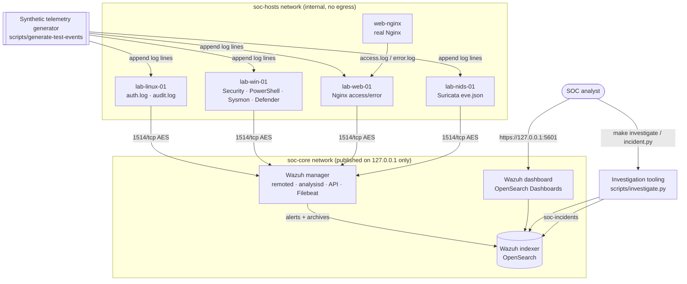
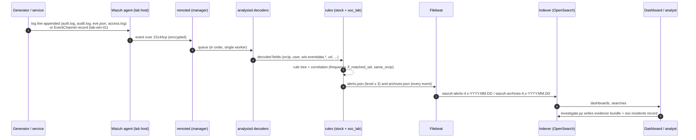

# Architecture

## Components

| Component | Image / version | Role |
|---|---|---|
| `wazuh.indexer` | `wazuh/wazuh-indexer:4.14.8` (OpenSearch 2.19.6) | Storage and search for alerts (`wazuh-alerts-4.x-*`), all decoded events (`wazuh-archives-4.x-*`) and incidents (`soc-incidents`) |
| `wazuh.manager` | `wazuh/wazuh-manager:4.14.8` | Agent enrollment/transport (authd, remoted), decoding and rule engine (analysisd), REST API, Filebeat shipper |
| `wazuh.dashboard` | `wazuh/wazuh-dashboard:4.14.8` (OpenSearch Dashboards 2.19.6) | Analyst UI, the *SOC Lab – Security Overview* dashboard |
| `lab-linux-01` | `wazuh/wazuh-agent:4.14.8` | Linux server: `auth.log` (sshd, sudo, useradd/usermod) and `audit.log` (auditd EXECVE) |
| `lab-win-01` | `wazuh/wazuh-agent:4.14.8` + EventChannel forwarder | Windows workstation telemetry: Security, PowerShell/Operational, Sysmon, Defender event channels |
| `lab-web-01` | `wazuh/wazuh-agent:4.14.8` | Collects the Nginx access and error logs |
| `web-nginx` | `nginx:1.27-alpine` | Real web server whose logs feed `lab-web-01` |
| `lab-nids-01` | `wazuh/wazuh-agent:4.14.8` | Network IDS sensor: Suricata EVE JSON alerts |

All components run in Docker Compose on one host. The indexer, manager API and dashboard are published on
`127.0.0.1` only. The lab hosts sit on `soc-hosts`, an **internal** Docker network with no route out of the host.



## Alert pipeline



| Pipeline stage | Implementation | Verified by |
|---|---|---|
| Telemetry | Real Nginx logs + deterministic synthetic fixtures | `test_ingestion.py`, `test_detections_e2e.py` |
| Agent / collector | Wazuh agent logcollector (`syslog`, `audit`, `json`), EventChannel queue for Windows | heartbeat per host (`health-check.sh`, `test_ingestion.py`) |
| Parser | Stock decoders (`sshd`, `sudo`, `auditd`, `web-accesslog`, `nginx-errorlog`, `json`, `windows_eventchannel`) + `soc_lab_decoders.xml` | decoder assertions in tests |
| Detection rule | `soc_lab_rules.xml` (36 detections) on top of the stock ruleset | `test_logtest.py`, `test_detections_e2e.py` |
| Alert | `alerts.json` → Filebeat → `wazuh-alerts-4.x-*` | e2e: rule id, level, MITRE, agent, location, fields |
| Dashboard | `dashboards/soc-overview.ndjson` | `test_dashboards.py` (objects + every panel has data) |
| SOC investigation | `scripts/investigate.py`, `scripts/incident.py`, playbooks | `test_investigation.py` |

## Simulated Windows host

No Windows VM is available in a Docker-only lab. `lab-win-01` runs the Linux Wazuh agent plus
`agents/windows/eventchannel-forwarder.py`, which pushes each synthetic record into the agent's local queue
exactly as the Windows agent's EventChannel reader does: queue `f`, location `EventChannel`, payload
`{"Message": …, "Event": "<Event xml…>"}`. From there everything is the genuine Wazuh path. The manager decodes
the records with the built-in `windows_eventchannel` decoder and evaluates the stock Windows, Sysmon,
PowerShell and Defender rules. The event XML matches what `Get-WinEvent … .ToXml()` produces. The agent
inventory still reports Linux as the OS of `lab-win-01`.

## Determinism settings

By default the Wazuh manager uses one remoted and analysisd worker per CPU. A burst of events written in the
same millisecond can then be matched out of order, so correlation rules can miss by one event. The lab sets
`remoted.worker_pool=1`, `analysisd.event_threads=1`, `analysisd.winevt_threads=1` and
`analysisd.rule_matching_threads=1` (`wazuh/entrypoint-scripts/20-deterministic-analysisd.sh`). Every
correlation is then reproducible under test. The lab's event rate is small, so this has no practical cost.

## Data stores

| Index | Content | Retention |
|---|---|---|
| `wazuh-alerts-4.x-*` | alerts (rule level ≥ 3) | daily index, kept until `make clean` |
| `wazuh-archives-4.x-*` | every decoded event (Filebeat archives enabled by `10-enable-archives.sh`) | daily index |
| `soc-incidents` | incident records (`opensearch/soc-incidents-mapping.json`, strict mapping) | until `make clean` |
| `runtime/evidence/<INC>/` | evidence bundles with SHA-256 manifests | local files |

## Configuration layout

```
wazuh/manager/etc/          -> copied to /var/ossec/etc on every manager start
    ossec.conf               manager config (archives on, vuln feeds off, agent re-enrolment allowed)
    rules/soc_lab_rules.xml  SOC lab detections (100090-100299)
    decoders/soc_lab_decoders.xml
wazuh/entrypoint-scripts/   run by the manager image before the daemons start
    00-restart-safety.sh     stale PID cleanup + first-boot data path (safe in-place restarts)
    10-enable-archives.sh    Filebeat ships archives.json
    20-deterministic-analysisd.sh
wazuh/indexer, wazuh/dashboard   OpenSearch / OpenSearch Dashboards config
wazuh/generated/            rendered from .env by scripts/render_config.py (bcrypt hashes, API creds)
wazuh/certs/                TLS certificates (wazuh-certs-generator)
agents/<role>/config/ossec.conf  per-host agent configuration
```
