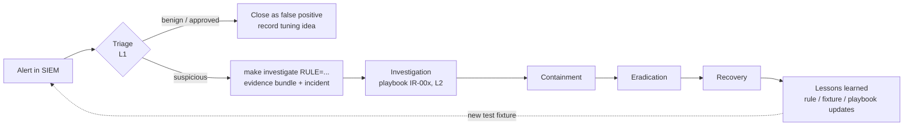

# Incident response

## Process



| Severity | Wazuh level | Triage SLA | Who |
|---|---|---|---|
| critical | 15 | immediate | L2 + incident manager |
| high | 12-14 | 15 min | L1 → L2 |
| medium | 7-11 | 1 h | L1 |
| low | 0-6 | daily review | L1 (context for correlations) |

## Playbooks

| Playbook | Scope | Detections |
|---|---|---|
| [IR-001](../playbooks/IR-001-authentication-abuse.md) | Authentication abuse | 100100-100102, 100110-100112 |
| [IR-002](../playbooks/IR-002-suspicious-privilege-activity.md) | Suspicious privilege activity | 100120-100122, 100180, 100182, 100183 |
| [IR-003](../playbooks/IR-003-suspicious-web-activity.md) | Suspicious web activity | 100160-100175 |
| [IR-004](../playbooks/IR-004-suspicious-powershell-activity.md) | Suspicious PowerShell activity | 100130, 100131 |
| [IR-005](../playbooks/IR-005-network-reconnaissance.md) | Network reconnaissance indicator | 100150, 100151 |
| [IR-006](../playbooks/IR-006-suspicious-execution-and-c2.md) | Suspicious execution and outbound C2 | 100140-100142, 100200, 100201 |
| [IR-007](../playbooks/IR-007-security-control-tampering.md) | Security control tampering | 100132, 100190-100193 |

Every playbook has the same structure: 1 Detection · 2 Triage · 3 Investigation · 4 Evidence collection ·
5 Containment · 6 Eradication · 7 Recovery · 8 Lessons learned, followed by *Logs to inspect*,
*Indicators of compromise* and *Escalation criteria*. `tests/integration/test_playbooks.py` enforces this
structure and checks that each playbook references all of its rules.

## Investigation tooling

```bash
# 1. find what fired (dashboard, or the API)
make incidents                                   # open incidents
# 2. investigate the newest alert of a rule (optionally for one source IP)
make investigate RULE=100102 SRCIP=198.51.100.24
#    -> runtime/evidence/INC-<date>-<time>-100102/
#         report.md            summary, ATT&CK, indicators, recommended response, FP notes
#         alert.json           the triggering alert
#         related_alerts.json  alerts for the same IPs/users/host within ±30 min
#         raw_events.jsonl     the decoded raw events (archives) for the same pivots
#         indicators.json      IPs, users, URLs, command lines, processes, signatures
#         timeline.md          chronological alert timeline
#         incident.json        the incident record
#         sha256sums.txt       integrity manifest (chain of custody)
#    -> soc-incidents/<INC>  (status: open)  - visible on the dashboard "Open incidents" panel
# 3. work the playbook, then track the state
PYTHONPATH=scripts .venv/bin/python scripts/incident.py update <INC> --status contained --note "source blocked"
PYTHONPATH=scripts .venv/bin/python scripts/incident.py close  <INC> --resolution "..." --analyst <name>
```

To check that evidence hasn't been modified after collection:
`cd runtime/evidence/<INC> && sha256sum -c sha256sums.txt`.

## Useful searches (Discover → `wazuh-alerts-4.x-*`)

| Question | DQL |
|---|---|
| All SOC detections | `rule.groups:soc_lab and not rule.groups:soc_health` |
| High/critical only | `rule.groups:soc_lab and rule.level >= 12` |
| Everything from one source | `data.srcip:"198.51.100.23" or data.src_ip:"198.51.100.23" or data.win.eventdata.ipAddress:"198.51.100.23"` |
| One ATT&CK technique | `rule.mitre.id:"T1110.001"` |
| Correlation alerts | `rule.groups:soc_correlation` |
| Raw events for a host (`wazuh-archives-4.x-*`) | `agent.name:"lab-linux-01"` |

## Escalation matrix

| Condition | Action |
|---|---|
| Any high alert with evidence of success (2xx on exploit, login after brute force, payload executed) | L2 + incident manager, declare incident |
| Privileged account involved, or security control tampered without a change record | L2 immediately |
| Same indicator on more than one host | Major incident |
| Approved activity (scanner, change ticket) | Close as benign, document, consider tuning |
